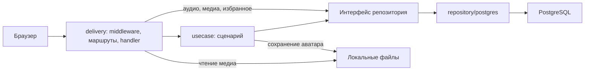
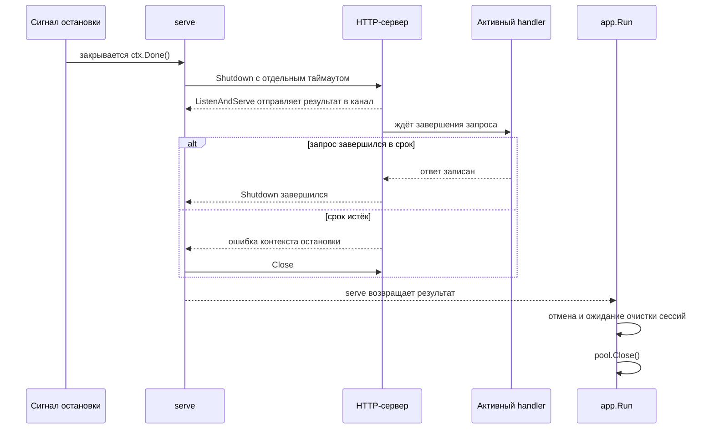

# Пофункциональный разбор бэкенда

Разбор написан по файлам рабочей копии `MUSIC-54` на 11 ноября 2026 года. В рабочей копии уже есть изменения из `dev`, а в индексе Git ещё отмечены конфликты начатого слияния. Поэтому для сверки открывай файлы из рабочей папки. [Точка сборки приложения](internal/app/http.go)

- [Три слоя и их связи](#три-слоя-и-их-связи)
- [Как проходит HTTP-запрос](#как-проходит-http-запрос)
- [Музыка и изображения](#музыка-и-изображения)
- [Валидация и ответы об ошибках](#валидация-и-ответы-об-ошибках)
- [Graceful shutdown](#graceful-shutdown)
- [Zerolog и context.Context](#zerolog-и-contextcontext)
- [Пофункциональный справочник](#пофункциональный-справочник)

## Три слоя и их связи

| Папка | Ответственность | Пример |
|---|---|---|
| `internal/delivery` | Протокол HTTP. Маршрутизация, middleware, чтение запроса, JSON и отправка файлов | `auth.Handler.Login` декодирует JSON, вызывает сценарий входа и выставляет cookies |
| `internal/usecase` | Сценарии приложения и правила предметной области | `auth.Usecase.Login` проверяет пароль и создаёт сессию |
| `internal/repository/postgres` | Хранение данных. SQL, транзакции и перевод результатов драйвера в модели и ошибки приложения | `UserRepo.GetByEmail` читает аккаунт, `SessionRepo.Create` записывает сессию |

`internal/models` содержит сущности, типы ID и ошибки, которыми обмениваются слои. `internal/usecase/ports` описывает интерфейсы репозиториев и хешера. Сценарий авторизации принимает `ports.UserRepository`, поэтому в рабочем сервере можно передать `UserRepo`, а в тесте — подмену. Выражение `var _ ports.UserRepository = (*UserRepo)(nil)` проверяет при компиляции, что у репозитория есть нужные методы.

`internal/app.newHandler` — место, где создаются реальные зависимости и соединяются слои. Он открывает локальное хранилище, берёт репозитории с общим пулом PostgreSQL, создаёт usecase и передаёт всё в `handlers.New`. В коде есть короткие пути: обработчики медиа и избранного вызывают узкие интерфейсы репозиториев напрямую, а `/health` формирует ответ сам. Это видно в составе `handlers.Deps`. [Сборка зависимостей](internal/app/http.go) · [Маршруты и зависимости](internal/delivery/handlers/routes.go) · [Интерфейсы](internal/usecase/ports/repository.go)



## Как проходит HTTP-запрос

На старте Docker выполняет миграции, затем запускает `app server`. В Go путь запуска идёт через `main → execute → run → app.Run → newHandler → serve`. `app.Run` создаёт пул, проверяет подключение к БД, собирает сервер и запускает очистку сессий. Уже работающий HTTP-сервер вызывает обработчик с `w http.ResponseWriter` для записи ответа и `r *http.Request` с методом, путём, заголовками, телом и контекстом. [Точка входа](cmd/app/main.go) · [Запуск приложения](internal/app/app.go) · [Compose](compose.yaml)

### Порядок middleware

```text
WithRequestID → WithLogging → WithRecover → WithCORS
    → WithCSRF → WithJSONErrors → ServeMux
        → WithAuth на защищённом маршруте → handler
```

1. `WithRequestID` берёт валидный UUID из `X-Request-ID` или создаёт свой. Он помещает ID в контекст и заголовок ответа.
2. `WithLogging` создаёт логгер запроса и оборачивает writer для измерения статуса и байтов. Он записывает итоговое событие после возврата внутренних обёрток.
3. `WithRecover` перехватывает панику во вложенном коде. Если ответ ещё можно сформировать, возвращает JSON с `500`. Внешний `WithLogging` затем записывает статус. Если заголовки уже отправлены, новый вызов `WriteHeader(500)` не сменит зафиксированный статус.
4. `WithCORS` выставляет разрешающие заголовки для настроенного origin и отвечает `204` на `OPTIONS`, когда CORS включён. Такой запрос завершается до маршрутизации.
5. `WithCSRF` пропускает `GET`, `HEAD`, `OPTIONS`. Для остальных методов сверяет cookie `csrf_token` с заголовком `X-CSRF-Token` и может вернуть `403`.
6. `WithJSONErrors` оборачивает writer, чтобы ответы `404` и `405` имели JSON-формат API. Для `405` он сохраняет заголовки, выставленные маршрутизатором.
7. `ServeMux` выбирает handler по методу и пути. На защищённых маршрутах `WithAuth` читает `session_id`, проверяет сессию, добавляет её и дочерний логгер с `user_id` в контекст.
8. Handler читает входные данные и вызывает usecase либо репозиторий. Результат превращается в JSON, файл или ответ без тела. После возврата handler внешняя обёртка пишет access-log с фактически зафиксированным статусом.

Первые обёртки выполняются до выбора маршрута, поэтому ответ CSRF или CORS тоже получает `X-Request-ID` и access-log. `WithAuth` подключается внутри маршрутизатора, а `GET /api/v1/auth/me` проверяет сессию через собственный handler и usecase. [Сборка middleware](internal/app/http.go) · [Маршруты](internal/delivery/handlers/routes.go)

### Маршруты текущего сервера

| Метод и путь | Handler | Что происходит дальше |
|---|---|---|
| `GET /health` | `health.Health` | Возвращает `{"status":"ok"}` |
| `GET /api/v1/auth/csrf` | `auth.Handler.CSRF` | Генерирует токен, выставляет cookie и возвращает токен в JSON |
| `POST /api/v1/auth/signup` | `auth.Handler.Signup` | Проверяет данные, создаёт аккаунт и сессию |
| `POST /api/v1/auth/login` | `auth.Handler.Login` | Ищет аккаунт, проверяет bcrypt-хеш, создаёт сессию |
| `GET /api/v1/auth/me` | `auth.Handler.Me` | По cookie находит действующую сессию и аккаунт |
| `POST /api/v1/auth/logout` | `auth.Handler.Logout` | Удаляет сессию, очищает session и CSRF cookies |
| `GET /api/v1/home` | `home.Handler.Home` | Возвращает карточки треков, исполнителей и альбомов |
| `GET /api/v1/artists/{id}` | `artist.ArtistHandler.Get` | Возвращает исполнителя, его треки и альбомы |
| `GET /api/v1/users/{id}` | `ProfileHandler.Get` | Возвращает профиль владельца сессии |
| `PUT /api/v1/users/{id}` | `ProfileHandler.Update` | Обновляет имя профиля |
| `POST /api/v1/users/{id}/avatar` | `ProfileHandler.UploadAvatar` | Сохраняет изображение и привязывает его к аккаунту |
| `PUT /api/v1/users/{id}/email` | `AccountHandler.ChangeEmail` | Проверяет пароль и транзакционно обновляет email |
| `PUT /api/v1/users/{id}/password` | `AccountHandler.ChangePassword` | Обновляет хеш и удаляет сессии аккаунта |
| `DELETE /api/v1/users/{id}` | `AccountHandler.Delete` | Удаляет аккаунт после проверки владельца и пароля |
| `GET /api/v1/favorites` | `favorites.Handler.List` | Возвращает ID избранных опубликованных треков текущего пользователя |
| `PUT` или `DELETE /api/v1/tracks/{id}/favorite` | `favorites.Handler.Set` | Добавляет или убирает трек из избранного |
| `GET /api/v1/media/{id}` | `MediaHandler.Get` | Отдаёт файл по ID записи `media_file` |
| `GET /api/v1/tracks/{id}/audio` | `MediaHandler.Audio` | Отдаёт аудио опубликованного трека по ID трека |

### Разбор одного чтения и одной записи

**Главная.** `home.Handler.Home` передаёт `r.Context()` в `catalog.Usecase.Home`. Сценарий последовательно вызывает `HomeTracks`, `HomeArtists`, `HomeAlbums` с лимитом 20 на раздел. PostgreSQL возвращает строки. `readTracks` и `readAlbums` собирают из строк JOIN по одной карточке на трек или альбом, добавляя связанных исполнителей. Handler преобразует модели в DTO и записывает `200` через `WriteJSON`. При ошибке чтения сценарий завершает работу, а handler возвращает `500`. [Handler](internal/delivery/handlers/home/handler.go) · [Usecase](internal/usecase/catalog/usecase.go) · [SQL](internal/repository/postgres/catalog_repo.go)

**Вход.** Клиент получает CSRF-токен через `GET /api/v1/auth/csrf`. Для `POST /api/v1/auth/login` отправляет cookie и совпадающий заголовок. После проверки CSRF handler декодирует email и пароль, `Login` нормализует их, читает аккаунт по email и проверяет bcrypt-хеш. `signIn` создаёт UUID сессии и сохраняет её в `auth_session`. Handler ставит `session_id`, выдаёт новую CSRF-cookie и возвращает DTO пользователя. Клиент использует обновлённую CSRF-cookie для следующих запросов записи. Ошибка пароля или неизвестный email дают одинаковый ответ `401 invalid_credentials`. [Вход](internal/delivery/handlers/auth/auth.go) · [Usecase авторизации](internal/usecase/auth/usecase.go)

## Музыка и изображения

### Что хранится в базе и на диске

`media_file` содержит метаданные: UUID, `storage_key`, MIME-тип, размер, длительность для аудио и даты. Байты находятся в локальном каталоге. В Compose каталог `./media` на компьютере смонтирован как `/app/media` в контейнере, и сервер получает `MEDIA_ROOT=/app/media`. При прямом запуске Go значение по умолчанию — `data/media`. Демонстрационный скрипт `scripts/seed_demo.py` генерирует WAV в `media/audio/demo/` и создаёт соответствующие записи в БД. В таблице `track` поле `audio_file_id` связывает трек с файлом. Аватары, изображения исполнителей и обложки имеют собственные ссылки на медиа. [Compose](compose.yaml) · [Локальное хранилище](internal/storage/local.go) · [Миграция storage_key](db/migrations/000005_media_local_storage.up.sql) · [Демо-данные](scripts/seed_demo.py)

### Как отдаётся музыка

1. Плеер берёт ID трека из каталога и запрашивает `GET /api/v1/tracks/{id}/audio`. JSON главной содержит сведения о треке и `duration_ms`. Аудиоданные приходят отдельным HTTP-ответом.
2. `MediaHandler.Audio` валидирует UUID. `TrackRepo.GetAudio` делает JOIN `track → media_file` и проверяет `status = 'published'`. Результат содержит ключ файла и MIME-тип.
3. `MediaHandler.serve` вызывает `Local.Open(storageKey)`, проверяет через `Stat`, что открыт обычный файл, и выставляет `Content-Type`, `X-Content-Type-Options: nosniff`, `Cache-Control: public, max-age=3600`.
4. `http.ServeContent` читает `*os.File`, который умеет `Read` и `Seek`. При `Range: bytes=2-4` допустимый диапазон возвращается как `206 Partial Content` с `Content-Range`. Это позволяет плееру запрашивать части файла. Библиотека также учитывает условные запросы на основе переданного времени изменения. Handler закрывает файл через `defer`. [Выдача файла](internal/delivery/handlers/media/handler.go) · [Запрос аудио](internal/repository/postgres/track_repo.go#L65) · [ServeContent](https://pkg.go.dev/net/http#ServeContent)

Тест с десятью байтами проверяет ответ `234` для диапазона `2-4` и лог `response_bytes=3` со статусом `206`. Счётчик считает результат вызовов `ResponseWriter.Write`, поэтому описывает байты тела, переданные writer. [Тест диапазона](internal/delivery/handlers/media/handler_test.go)

### Как загружается и отдаётся картинка

Для аватара клиент отправляет `multipart/form-data` с полем `avatar` на `POST /api/v1/users/{id}/avatar`. Handler ограничивает всё тело, разбирает multipart, читает до `2 МиБ + 1 байт` и определяет тип по содержимому. Usecase проверяет владельца, размер и допустимый MIME-тип, генерирует ключ `images/avatars/<uuid>.<ext>` и сохраняет байты на диск. Затем `MediaRepo.Create` создаёт метаданные, а `UserRepo.SetAvatar` записывает ID файла в аккаунт. Клиент получает профиль с `avatar_url: "/api/v1/media/<id>"`. [Загрузка](internal/delivery/handlers/profile/handler.go#L108) · [Сценарий](internal/usecase/profile/usecase.go#L113)

При запросе `GET /api/v1/media/{id}` handler ищет файл по UUID медиа, открывает его и отдаёт тем же `serve`. Этот маршрут использует `media_file.id`; маршрут аудио принимает `track.id` и проверяет публикацию трека.

DTO каталога и страницы исполнителя читают готовые `CoverURL` и `ImageURL` из моделей. В текущем коде выборки главной эти URL не заполняют, поэтому в JSON возможны `cover_url: null` и `image_url: null`. У аватара путь формируется явно. При сбое сохранения метаданных или привязки аватара usecase пытается удалить новый файл. Операции диска и БД выполняются отдельно, поэтому, например, после успешной вставки `media_file` и ошибки привязки запись метаданных может остаться. [Мапперы каталога](internal/delivery/handlers/home/mapper.go) · [Выборки каталога](internal/repository/postgres/catalog_repo.go) · [Чтение аккаунта](internal/repository/postgres/user_repo.go#L99)

## Валидация и ответы об ошибках

| Где | Что проверяется | Пример |
|---|---|---|
| Delivery | Можно ли прочитать запрос и соответствуют ли параметры формату API | JSON, UUID в пути, `limit=1..100`, `offset>=0`, поле multipart |
| Usecase и `internal/validation` | Допустимы ли значения и разрешено ли действие | Владелец профиля, пароль, допустимый MIME-тип, отдельный сценарий смены email |
| Репозиторий и БД | Выполняются ли условия хранения | Уникальный email, внешние ключи, условия SQL, проверка хеша под блокировкой |

- **Регистрация.** Handler ограничивает тело одним МиБ и декодирует JSON. `validation.Signup` проверяет поля за один проход. Email обрезается и переводится в нижний регистр. Проверка формата требует непустые части до и после `@`, точку в домене и отсутствие обычных пробельных символов. Это проверка формата строки, доставка письма здесь не проверяется. Имя должно иметь 2–50 Unicode-символов. Пароль после обрезки краёв должен иметь минимум 8 Unicode-символов, не более 72 байт, букву и цифру. `Hash` дополнительно проверяет байтовый предел bcrypt. [Проверки полей](internal/validation/user_validation.go) · [Хешер](internal/auth/password.go)
- **Вход.** `validation.Login` требует заполненность нормализованных email и пароля. Совпадение проверяет bcrypt, а проверка сложности применяется при регистрации и выборе нового пароля. [Login](internal/validation/user_validation.go#L113)
- **Профиль.** Handler проверяет входные поля, usecase проверяет их ещё раз и сверяет владельца. Обычное обновление меняет `display_name`. Репозиторий добавляет в `WHERE` текущий email, чтобы не записать имя на основании устаревшего профиля. Смена email и пароля имеет отдельные маршруты с проверкой текущего пароля. Handler аккаунта отклоняет неизвестные JSON-поля и данные после первого JSON-объекта. [Профиль](internal/usecase/profile/usecase.go#L73) · [Аккаунт](internal/delivery/handlers/profile/account.go#L37)
- **Аватар.** Лимит файла — 2 097 152 байта. Лимит запроса выше на один МиБ, чтобы вместить multipart. MIME определяется по байтам, разрешены JPEG, PNG и WebP. `ParseMultipartForm` и его временные файлы обслуживает delivery, выбор ключа и запись в хранилище выполняет usecase. [Загрузка аватара](internal/delivery/handlers/profile/handler.go#L108)
- **Сессия и CSRF.** `WithAuth` проверяет действующую сессию, а `WithCSRF` проверяет cookie и заголовок для запроса записи. CSRF-cookie доступна клиентскому коду для копирования токена в заголовок. Session-cookie выставляется с `HttpOnly`. Значения `Secure` и `SameSite` определяет конфигурация. [Cookie сессии](internal/delivery/handlers/auth/cookie.go) · [Проверка CSRF](internal/security/csrf.go)

При ошибках полей usecase возвращает ошибку с `Fields map[string]string`. Handler распознаёт её через `errors.As`, передаёт поля в `WriteFieldsError` и возвращает `400`. `errors.Is` находит известную ошибку даже под обёрткой `fmt.Errorf("...: %w", err)`. Так `ErrEmailTaken` становится `409`, запрет действия — `403`, а неизвестный сбой — `500`. Код ошибки используется фронтендом, а сообщение показывается пользователю. Техническая причина записывается отдельным событием. [Ошибки auth](internal/delivery/handlers/auth/errors.go) · [Ошибки profile](internal/delivery/handlers/profile/handler.go#L181) · [JSON-формат](internal/delivery/response/response.go)

## Graceful shutdown

Graceful shutdown — последовательность остановки, при которой сервер прекращает принимать новые соединения, даёт время активным запросам и закрывает зависимости после завершения работы. В этом проекте участвуют `execute`, `app.Run`, `serve` и фоновый цикл очистки сессий. [Точка входа](cmd/app/main.go#L29) · [Жизненный цикл приложения](internal/app/app.go#L15) · [Остановка HTTP-сервера](internal/app/http.go#L66)

### Сигнал, слушатель и активный запрос

1. `execute` вызывает `signal.NotifyContext(context.Background(), os.Interrupt, syscall.SIGTERM)`. Когда приходит подходящий сигнал, закрывается `ctx.Done()`. `defer stop()` освобождает регистрацию сигналов при выходе из `execute`. [NotifyContext](https://pkg.go.dev/os/signal#NotifyContext)
2. `serve` запускает `ListenAndServe` в отдельной goroutine и получает её результат через буферизированный `serverErrors`. Главная goroutine ждёт либо результат сервера, либо закрытие `ctx.Done()`. Ошибка запуска, например занятый порт, идёт вверх сразу. `http.ErrServerClosed` преобразуется в `nil` как штатный результат остановки.
3. После сигнала `serve` создаёт `shutdownCtx` через `context.WithTimeout(context.Background(), timeout)`. Исходный контекст приложения к этому моменту уже отменён. Новый контекст даёт остановке собственный срок. По умолчанию `APP_SHUTDOWN_TIMEOUT=10s`.
4. `server.Shutdown(shutdownCtx)` закрывает слушатели и простаивающие соединения, затем ждёт завершения активных. Контексты входящих запросов в этом приложении создаёт `net/http`. У сервера в рабочем коде отсутствует `BaseContext`, который связывал бы их с контекстом сигнала. Поэтому сигнал сам по себе оставляет активному handler время закончить работу. [Shutdown](https://pkg.go.dev/net/http#Server.Shutdown) · [Request.Context](https://pkg.go.dev/net/http#Request.Context)
5. `ListenAndServe` может вернуться сразу после закрытия слушателя, пока `Shutdown` ещё ждёт handler. `serve` сначала дожидается результата `Shutdown`, потом читает результат `ListenAndServe` из канала. Это предотвращает преждевременный выход процесса.
6. Если `Shutdown` возвращает ошибку, например по истечении срока, код вызывает `server.Close()` и получает результат goroutine сервера. `Close` закрывает активные соединения, поэтому длинная передача аудио может оборваться. Ошибки остановки объединяются через `errors.Join`. [Close](https://pkg.go.dev/net/http#Server.Close)



### Почему пул PostgreSQL закрывается последним

`app.Run` регистрирует `defer pool.Close()` сразу после подключения. Позже регистрирует второй `defer`, который отменяет `cleanupCtx` и ждёт закрытия `cleanupDone`. Отложенные функции выполняются в обратном порядке. После возврата из `serve` сначала останавливается очистка сессий, затем закрывается пул. Пока активный HTTP-запрос завершает работу в пределах `Shutdown`, пул доступен. [Run](internal/app/app.go#L15)

Очистка использует дочерний контекст приложения. Она пытается удалить истёкшие сессии при старте и затем раз в час. Каждый вызов получает собственный таймаут в 5 секунд, после вызова выполняется `cancel()`. При сигнале остановки родитель отменяется и фоновая goroutine завершается. При ошибке старта HTTP-сервера её останавливает отложенная функция `app.Run`. [Очистка сессий](internal/app/sessions.go)

| Настройка | Что она ограничивает |
|---|---|
| `ReadHeaderTimeout=3s` | Чтение заголовков HTTP |
| `ReadTimeout=15s` | Чтение HTTP-запроса, включая тело |
| `WriteTimeout=0` | Запись ответа без заданного таймаута на этом уровне |
| `IdleTimeout=60s` | Ожидание следующего запроса на keep-alive соединении |
| `APP_SHUTDOWN_TIMEOUT=10s` по умолчанию | Ожидание завершения HTTP-сервера после сигнала |
| `stop_grace_period: 15s` | Ожидание Docker перед принудительной остановкой контейнера |

Таймауты HTTP и бюджет остановки решают разные задачи. Даже при `WriteTimeout=0` продолжающаяся передача файла ограничена бюджетом graceful shutdown после сигнала. `TestServeWaitsForActiveRequest` удерживает handler, запускает остановку, убеждается, что `serve` ещё ждёт, затем отпускает handler и проверяет успешное завершение. [Настройки HTTP](internal/app/http.go#L55) · [Compose](compose.yaml) · [Тест остановки](internal/app/http_test.go#L27)

## Zerolog и context.Context

В проекте `ctx` сопровождает операцию и переносит отмену, срок и служебные значения. Функция `GetByID(ctx, id)` получает `id` явно, а через `ctx` узнаёт, к какому запросу относится чтение и можно ли продолжать работу. `context.WithValue` создаёт производный контекст. Значения родителя остаются доступны потомку, а отмена родителя распространяется вниз. [Пакет context](https://pkg.go.dev/context)

### Контексты с разным временем жизни

| Контекст | Где создаётся | Что в нём |
|---|---|---|
| Контекст приложения | `execute`, затем `app.Run` добавляет логгер | Сигнал остановки, базовый логгер |
| Контекст HTTP-запроса | `net/http`, затем middleware | Отмена запроса, `request_id`, логгер, на защищённых маршрутах сессия и `user_id` |
| Контекст отдельного SQL-вызова | Репозиторий и `TraceQueryStart` | Данные родителя, имя операции, время начала, вид команды |
| Контекст остановки | `serve` после сигнала | Отдельный срок ожидания `Shutdown` |

Если клиент закрывает соединение, отмена запроса передаётся в pgx, поскольку handler, usecase и репозиторий передают `ctx` дальше. Обычный `context.Background()` внутри репозитория разорвал бы эту связь и убрал значения запроса. Отмена кооперативная. Код реагирует на неё через `ctx.Done()` или передаёт контекст операции, которая его учитывает. [Request.Context](https://pkg.go.dev/net/http#Request.Context) · [Пакет context](https://pkg.go.dev/context)

### Как появляется логгер запроса

1. В `run` создаётся базовый логгер `logger.New(os.Stdout, cfg.LogLevel, cfg.LogFormat)`. Он добавляет timestamp и `service=music-api`. `LOG_LEVEL` управляет порогом, `LOG_FORMAT` выбирает JSON или console. Отдельный стартовый логгер в `main` пишет ошибку команды в `stderr`, в том числе при ошибке конфигурации.
2. `WithRequestID` записывает строку ID под своим типизированным ключом контекста. Это значение можно получить через `logger.RequestID(ctx)`. Такой ID нужен для корреляции событий.
3. `WithLogging` создаёт от базового логгера дочерний с полем `request_id` и прикрепляет его к контексту. Значение ID и объект логгера хранятся под разными ключами. Сам логгер извлекается через `zerolog.Ctx(ctx)`.
4. `WithAuth` после успешного чтения сессии добавляет значение сессии и создаёт ещё одного потомка логгера с `user_id`. События защищённого handler и его потомков получают оба поля. Внешний access-log по-прежнему использует экземпляр, созданный до вызова auth middleware. Потомок контекста передаётся внутрь вызова.

```go
requestLogger := logger.With().
    Str("request_id", RequestIDFromContext(r.Context())).
    Logger()

r = r.WithContext(requestLogger.WithContext(r.Context()))
next.ServeHTTP(sw, r)
```

`With()` строит дочерний логгер с дополнительными полями. `WithContext()` возвращает контекст с уже созданным логгером. `r.WithContext()` возвращает копию запроса с этим контекстом. Следующий handler должен получить именно её. Когда обработчики параллельно создают собственные дочерние логгеры, каждому достаются его поля, а общий базовый логгер можно переиспользовать. Если логгер отсутствует в контексте и `DefaultContextLogger` не задан, `zerolog.Ctx` возвращает отключённый логгер. Это объясняет, почему тесты, вызывающие usecase с `context.Background()`, могут не печатать его логи. [Middleware](internal/delivery/middleware/logging.go#L13) · [WithAuth](internal/delivery/middleware/auth.go#L19) · [Исходный код zerolog](https://github.com/rs/zerolog/blob/v1.34.0/ctx.go)

### Как проследить запрос до PostgreSQL

```text
WithLogging              → логгер с request_id
catalog.Usecase.Home     → layer=usecase, operation=catalog.home, phase=start
CatalogRepo.HomeTracks   → добавляет имя catalog.home_tracks в ctx
pgx.Query                → phase=start, db_statement=WITH
pgx QueryTracer          → phase=finish, duration_ms, outcome
                         → аналогично для исполнителей и альбомов
WithLogging              → HTTP-статус, время запроса, response_bytes
```

Usecase извлекает логгер из контекста и пишет этапы сценария. Репозиторий добавляет имя операции через `withDBOperation`, сохраняя родительский логгер. `connectPostgres` один раз назначает `QueryTracer` для соединений пула. Драйвер вызывает его для `Query`, `QueryRow` и `Exec`, включая SQL-вызовы в транзакциях. `TraceQueryStart` сохраняет время и название операции. `TraceQueryEnd` использует возвращённый контекст и записывает длительность, исход и число строк из command tag при успехе. У ошибки PostgreSQL может появиться `sqlstate`. Трассировка ведётся на `debug`. [Подключение](internal/app/app.go#L46) · [Трейсер](internal/repository/postgres/query_tracer.go) · [Контракт pgx](https://github.com/jackc/pgx/blob/v5.11.0/tracer.go)

В трейсер поступают SQL и параметры, но событие получает только вид команды из списка вроде `SELECT`, `WITH` или `UPDATE`, плюс фиксированное имя операции. Благодаря этому диагностические события не включают сырые параметры и текст ошибки драйвера. `outcome=ok` описывает результат на уровне драйвера. Даже успешный запрос с нулём строк может стать `ErrUserNotFound` после обработки результата. `duration_ms` трейcера описывает конкретный вызов драйвера, а поле с тем же именем в access-log — весь HTTP-запрос.

В HTTP-событии `content_length` относится к входящему телу, `response_bytes` — к записанному телу ответа. Путь берётся из `r.URL.Path`, без query string. Уровень access-log вычисляется по статусу. Для 4xx это warn, для 5xx error, для остальных — info. Строка `Msg(...)` завершает цепочку записи zerolog. При панике до отправки ответа в логах могут быть и событие recovery со стеком, и итоговый `500` с одним `request_id`. [HTTP-лог](internal/delivery/middleware/logging.go) · [Recovery](internal/delivery/middleware/recover.go)

Для просмотра последовательности в PowerShell из корня проекта можно выполнить:

```powershell
$env:LOG_LEVEL = 'debug'
docker compose up --build --wait
$response = Invoke-WebRequest http://localhost:8080/api/v1/home
$requestId = $response.Headers['X-Request-ID'] -join ''
docker compose logs --no-color server | Select-String -SimpleMatch $requestId
```

Два запроса к одному endpoint могут чередоваться в общем потоке логов. Фильтрация по ID восстанавливает историю одного запроса. При уровне `info` остаются итоговые HTTP-события и обычные записи usecase, а отладочные точки входа и SQL-трейсы скрыты. [Настройки уровня](internal/logger/logger.go#L12) · [Тест фильтрации](internal/repository/postgres/query_tracer_test.go#L75)

## Пофункциональный справочник

Здесь собраны именованные функции и методы из трёх слоёв. Анонимные функции внутри middleware разобраны по поведению самой обёртки. В конце перечислены функции запуска, валидации, логгера и хранилища.

### Delivery — маршруты и ответы

| Файл и функция | Что делает |
|---|---|
| `handlers/routes.go` · `New` | Собирает `API` из переданных зависимостей и отмечает доступность дополнительных маршрутов |
| `handlers/routes.go` · `API.Routes` | Регистрирует маршруты `ServeMux` и оборачивает защищённые handler в `WithAuth` |
| `health/handler.go` · `Health` | Записывает `200` с `status=ok` без запроса к базе |
| `response/response.go` · `WriteJSON` | Сериализует значение до отправки заголовков, затем пишет JSON. Ошибка сериализации даёт `500` без тела. Ошибка записи логируется через `ctx` |
| `response/response.go` · `WriteError` | Формирует объект `error` с кодом и сообщением и вызывает `WriteJSON` |
| `response/response.go` · `WriteFieldsError` | Добавляет к ошибке словарь сообщений по полям |

[Маршруты](internal/delivery/handlers/routes.go) · [Health](internal/delivery/handlers/health/handler.go) · [Запись ответа](internal/delivery/response/response.go)

### Delivery — middleware

| Функция | Что делает |
|---|---|
| `Chain` | Обходит список обёрток с конца, поэтому первая в списке становится внешней |
| `statusWriter.WriteHeader` | Запоминает первый окончательный HTTP-статус. Пропускает предварительные 1xx, отдельно учитывая 101 |
| `statusWriter.Write` | Учитывает неявный `200`, делегирует запись и прибавляет фактически записанные байты, включая частичную запись с ошибкой |
| `statusWriter.Unwrap` | Возвращает вложенный writer для механизма `http.ResponseController` |
| `WithRequestID` | Проверяет или создаёт UUID, записывает его в заголовок ответа и контекст |
| `RequestIDFromContext` | Читает ID через `logger.RequestID` |
| `WithLogging` | Создаёт логгер запроса, передаёт его в контексте, измеряет и пишет итоговый access-log |
| `accessLogLevel` | Выбирает warn для 4xx, error для 5xx и info для остальных статусов |
| `RealIP` | Берёт значение для лога из `X-Real-IP`, первого `X-Forwarded-For` или адреса соединения. Эти заголовки используются для диагностики |
| `WithRecover` | Перехватывает панику текущей goroutine во вложенном handler, пишет стек и пытается вернуть JSON с `500` |
| `WithCORS` | Добавляет CORS-заголовки при совпадении origin. При включённой обёртке завершает `OPTIONS` ответом `204` |
| `WithCSRF` | Для запросов записи сверяет CSRF-cookie и заголовок. При ошибке возвращает `403` до handler |
| `WithJSONErrors` | Подменяет writer на `errorInterceptor` и передаёт запрос дальше |
| `errorInterceptor.WriteHeader` | Превращает `404` и `405` в JSON, остальные статусы пропускает |
| `errorInterceptor.Write` | После подмены поглощает прежнее тело. Для остальных ответов пишет его обычным способом |
| `WithAuth` | Получает сессию через переданную функцию `SessionByID`. Возвращает `401` для отсутствующей или просроченной сессии и `500` при сбое. В успешном случае кладёт сессию и логгер с `user_id` в контекст |
| `SessionFromContext` | Достаёт `models.Session` из контекста и сообщает, было ли значение найдено |

[Исходники middleware](internal/delivery/middleware)

### Delivery — авторизация

| Функция | Что делает |
|---|---|
| `New` | Создаёт `Handler` с настройками cookie и интерфейсом авторизации |
| `Handler.Signup` | Ограничивает тело, декодирует данные, вызывает регистрацию, ставит session и CSRF cookies, пишет профиль с `201` |
| `Handler.Login` | Декодирует данные входа, вызывает проверку пароля и создание сессии, ставит cookies и пишет профиль с `200` |
| `Handler.sessionIDFromRequest` | Читает значение `session_id`, оборачивает ошибку чтения cookie |
| `Handler.Me` | Передаёт ID сессии в usecase и отдаёт данные текущего пользователя |
| `Handler.Logout` | Вызывает удаление сессии, очищает обе cookies, возвращает `204` |
| `Handler.CSRF` | Выдаёт новую CSRF-cookie и её значение в JSON |
| `Handler.issueCSRFCookie` | Генерирует токен и записывает cookie с настройками TTL, Secure и SameSite |
| `Handler.clearCSRFCookie` | Выставляет пустое значение с отрицательным MaxAge для удаления cookie |
| `Handler.setSessionCookie` | Выставляет `HttpOnly`-cookie с ID сессии и сроком из конфигурации |
| `Handler.clearSessionCookie` | Очищает session-cookie с тем же путём и параметрами |
| `Handler.sessionSameSite` | Возвращает `None`, когда настроен отдельный origin и включён Secure. Иначе использует `Lax` |
| `newUserResponse` | Собирает DTO пользователя, экранирует имя и добавляет URL аватара при наличии |
| `writeInternalError` | Пишет техническую ошибку в лог и возвращает общий `500` |
| `writeUnauthorized` | Пишет диагностическое событие на debug и возвращает `401 unauthorized` |
| `writeInvalidCredentials` | Возвращает единый `401 invalid_credentials` для неизвестного email и неверного пароля |
| `writeAuthError` | Выбирает ответ по типу ошибки. Валидация даёт `400`, занятый email — `409`, ожидаемые отказы — `401`, прочее — `500` |

[Исходники HTTP-авторизации](internal/delivery/handlers/auth)

### Delivery — каталог и артист

| Файл и функция | Что делает |
|---|---|
| `home/handler.go` · `New` | Сохраняет интерфейс сценария каталога |
| `home/handler.go` · `Handler.Home` | Получает три раздела каталога, преобразует их в DTO и пишет `200`. Сбой чтения логирует и преобразует в `500` |
| `home/mapper.go` · `newTrackResponses` | Формирует карточки с ID, названием, длительностью, обложкой и артистами |
| `home/mapper.go` · `newArtistResponses` | Формирует карточки исполнителей из ID, имени и поля URL изображения |
| `home/mapper.go` · `newAlbumResponses` | Формирует карточки альбомов с датой, обложкой и артистами |
| `home/mapper.go` · `newArtistRefResponses` | Превращает связанные записи исполнителей в пары ID и имени |
| `home/mapper.go` · `optionalString` | Превращает пустую строку в `nil`, чтобы получить `null` в JSON |
| `home/mapper.go` · `formatReleaseDate` | Превращает дату в строку `YYYY-MM-DD` в UTC, сохраняет отсутствие даты |
| `home/artist.go` · `NewArtistHandler` | Создаёт обработчик для отдельного интерфейса `Artist` из пакета home |
| `home/artist.go` · `ArtistHandler.Artist` | Читает пагинацию, вызывает сценарий `catalog.Artist` и собирает страницу. В текущих маршрутах этот handler не зарегистрирован |
| `artist/handler.go` · `NewArtistHandler` | Создаёт обработчик страницы исполнителя, который используется в `Routes` |
| `artist/handler.go` · `ArtistHandler.Get` | Проверяет UUID и параметры пагинации, вызывает `Page` или `PageAt`, возвращает DTO либо ошибку |
| `artist/response.go` · `newPageResponse` | Проверяет ID исполнителя и собирает биографию, ссылки, треки и альбомы |
| `artist/response.go` · `newTrackResponses` | Проверяет ID треков и связанных артистов, формирует карточки |
| `artist/response.go` · `newAlbumResponses` | Проверяет ID альбомов и артистов, форматирует даты |
| `artist/response.go` · `newArtistRefResponses` | Проверяет ID связанных исполнителей и формирует DTO |
| `artist/response.go` · `idToString` | Разбирает UUID и возвращает его каноническую запись |
| `artist/response.go` · `optionalString` | Представляет пустую ссылку как `nil` |
| `artist/response.go` · `formatReleaseDate` | Форматирует необязательную дату релиза в UTC |

У действующего маршрута исполнителя без параметров используется `Page` с лимитом 50. Если передан `limit` или `offset`, handler использует `PageAt` и значения по умолчанию 100 и 0 для отсутствующих параметров. [Действующий handler](internal/delivery/handlers/artist/handler.go) · [Home](internal/delivery/handlers/home)

### Delivery — профиль, аккаунт, медиа, избранное

| Функция | Что делает |
|---|---|
| `NewProfileHandler` | Сохраняет интерфейс сценариев профиля |
| `ProfileHandler.Get` | Читает сессию и UUID, вызывает чтение профиля, возвращает DTO |
| `ProfileHandler.Update` | Читает и проверяет JSON профиля, вызывает обновление и возвращает обновлённые данные |
| `ProfileHandler.UploadAvatar` | Принимает ограниченный multipart, определяет тип по байтам, передаёт файл usecase и отдаёт профиль |
| `parseUserID` | Извлекает `{id}`, валидирует UUID и при ошибке отвечает `404` |
| `writeProfileError` | Пишет соответствующий ответ для ошибки сценария. Возвращает `true` при `nil`, чтобы handler продолжил работу |
| `newProfileResponse` | Формирует DTO, экранирует имя, переводит дату создания в UTC и добавляет аватар при наличии |
| `profile.idToString` | Проверяет и нормализует UUID пользователя |
| `NewAccountHandler` | Сохраняет интерфейс сценариев аккаунта и конфигурацию cookie |
| `AccountHandler.request` | Проверяет сессию и совпадение владельца с путём, читает одно JSON-значение с пределом 16 КиБ |
| `writeAccountError` | Преобразует неверный текущий пароль в ошибку поля `current_password`, остальные ошибки делегирует `writeProfileError` |
| `AccountHandler.ChangeEmail` | Вызывает сценарий смены email и возвращает новый профиль |
| `AccountHandler.ChangePassword` | Вызывает сценарий смены пароля, очищает session-cookie, возвращает `204` |
| `AccountHandler.Delete` | Вызывает сценарий удаления аккаунта, очищает session-cookie, возвращает `204` |
| `AccountHandler.clearCookie` | Выставляет истёкшую session-cookie с учётом настроек |
| `NewMediaHandler` | Принимает репозиторий файлов, локальное хранилище и опциональный интерфейс чтения аудио трека |
| `MediaHandler.Get` | Валидирует UUID медиа и получает его метаданные через `MediaRepo` |
| `MediaHandler.Audio` | Валидирует UUID трека и получает метаданные через `TrackRepo.GetAudio` |
| `MediaHandler.serve` | Обрабатывает ошибки метаданных, открывает обычный файл и передаёт его `ServeContent` |
| `NewFavoritesHandler` | Сохраняет интерфейс репозитория избранного |
| `favorites.Handler.List` | Получает владельца из сессии, читает его избранные треки и отдаёт `track_ids` |
| `favorites.Handler.Set` | Разбирает ID, выбирает добавление для `PUT` или удаление для `DELETE`, вызывает репозиторий и возвращает `204` |

[Профиль и аккаунт](internal/delivery/handlers/profile) · [Медиа](internal/delivery/handlers/media/handler.go) · [Избранное](internal/delivery/handlers/favorites/handler.go)

### Usecase — авторизация и аккаунт

| Функция | Что делает |
|---|---|
| `auth.NewAuthUsecase` | Получает репозитории аккаунтов и сессий, хешер, генератор ID, часы и TTL |
| `auth.ValidationError.Error` | Реализует интерфейс `error`. Точные сообщения по полям лежат в `Fields` |
| `auth.Usecase.signIn` | Вычисляет время окончания сессии, создаёт UUID, сохраняет сессию и возвращает пользователя с сессией |
| `auth.Usecase.Signup` | Валидирует форму, хеширует пароль, создаёт аккаунт, затем вызывает `signIn` |
| `auth.Usecase.Login` | Валидирует поля, читает аккаунт, сверяет bcrypt-хеш и вызывает `signIn` |
| `auth.Usecase.SessionByID` | Читает сессию через порт, возвращает известные ошибки отсутствия и истечения, дополнительно сверяет время через переданные часы |
| `auth.Usecase.Me` | Проверяет сессию и читает пользователя по её `UserID`. Отсутствие сессии или пользователя преобразует в `ErrUnauthorized` |
| `auth.Usecase.Logout` | Делегирует удаление сессии. Пустой ID допускается |
| `account.NewAccountUsecase` | Получает порт чтения пользователя, порт изменений аккаунта и хешер |
| `account.Usecase.verify` | Сверяет владельца, проверяет наличие текущего пароля, читает пользователя и проверяет bcrypt-хеш |
| `account.Usecase.ChangeEmail` | Проверяет текущий пароль, валидирует новый email и передаёт его вместе с ожидаемым хешем в репозиторий |
| `account.Usecase.ChangePassword` | Проверяет текущий пароль, валидирует и хеширует новый, передаёт оба хеша для транзакционного изменения |
| `account.Usecase.Delete` | Проверяет пароль и владельца, запрещает удаление служебного аккаунта, делегирует удаление |

[Авторизация](internal/usecase/auth/usecase.go) · [Аккаунт](internal/usecase/account/usecase.go)

### Usecase — каталог, артист и профиль

| Функция | Что делает |
|---|---|
| `catalog.New` | Сохраняет интерфейс чтения каталога |
| `catalog.Usecase.Home` | Читает треки, исполнителей и альбомы по очереди с лимитом 20. При первой ошибке возвращает её с пояснением этапа |
| `catalog.NewArtistUsecase` | Создаёт сценарий артиста для альтернативного `home.ArtistHandler` |
| `catalog.ArtistUsecase.Artist` | Читает исполнителя, треки и альбомы с переданной пагинацией. Через текущий `API.Routes` не вызывается |
| `artist.NewArtistUsecase` | Создаёт сценарий исполнителя, подключённый к действующему маршруту |
| `artist.ArtistUsecase.Page` | Вызывает `PageAt` с лимитом 50 и смещением 0 |
| `artist.ArtistUsecase.PageAt` | Проверяет пагинацию, читает артиста и его треки и альбомы, собирает страницу |
| `profile.NewProfileUsecase` | Получает чтение аккаунтов, изменение профиля, метаданные медиа и запись файлов |
| `profile.ProfileUsecase.Get` | Проверяет владельца, читает пользователя, формирует URL аватара |
| `profile.ProfileUsecase.Update` | Проверяет владельца, валидирует профиль, сверяет текущий email и сохраняет отображаемое имя |
| `profile.ProfileUsecase.UploadAvatar` | Проверяет владельца, MIME и размер, сохраняет файл и метаданные, привязывает аватар, пытается удалить новый файл при последующем сбое |
| `ensureOwner` | Сравнивает ID из сессии и ID из запроса, возвращает `ErrForbidden` при различии |
| `withAvatarURL` | Добавляет URL `/api/v1/media/{id}` в модель при наличии `AvatarFileID` |
| `avatarExtension` | Определяет `jpg`, `png` или `webp` по разрешённому MIME |
| `DetectAvatarMIME` | Вызывает `http.DetectContentType` по байтам и проверяет результат через `avatarExtension` |

В `usecase/ports` лежат декларации `UserRepository`, `SessionRepository`, `CatalogRepository`, `PasswordHasher`, `ProfileRepository`, `MediaRepository`, `ArtistRepository` и `TrackRepository`. Тела методов находятся в адаптерах. `mocks` содержит сгенерированные подмены для тестов. [Порты](internal/usecase/ports) · [Каталог](internal/usecase/catalog) · [Артист](internal/usecase/artist/usecase.go) · [Профиль](internal/usecase/profile/usecase.go)

### Repository — аккаунт, профиль и сессии

| Функция | Что делает |
|---|---|
| `NewUserRepo` | Использует переданный пул для `QueryRow` и открытия транзакций |
| `UserRepo.Create` | Вставляет email, хеш, имя и опциональный аватар. Из `RETURNING` получает ID и дату |
| `UserRepo.GetByID` | Читает аккаунт по UUID, переводит отсутствие строки или некорректный ID в `ErrUserNotFound` |
| `UserRepo.GetByEmail` | Читает аккаунт по нормализованному email, включая хеш для bcrypt |
| `scanUser` | Сканирует строку в `models.User`, формирует URL и ID аватара при наличии |
| `isEmailConflict` | Проверяет SQLSTATE `23505` и имя ограничения `account_email_uk` |
| `isInvalidID` | Распознаёт SQLSTATE `22P02`, используемый здесь при ошибке преобразования ID |
| `UserRepo.UpdateProfile` | Меняет `display_name` по UUID при совпадении текущего email, возвращает обновлённую строку |
| `UserRepo.SetAvatar` | Меняет `avatar_file_id` и возвращает обновлённый аккаунт |
| `UserRepo.changeAccount` | Открывает транзакцию, читает хеш под `FOR UPDATE`, сравнивает с ожидаемым, выполняет переданное изменение и фиксирует. `defer Rollback` страхует ранний выход |
| `UserRepo.ChangeEmail` | Меняет email внутри `changeAccount`, переводит конфликт уникальности в `ErrEmailTaken` |
| `UserRepo.ChangePassword` | Меняет хеш и удаляет все сессии этого аккаунта в одной транзакции |
| `UserRepo.DeleteAccount` | Передаёт треки служебному аккаунту, удаляет историю прослушиваний и аккаунт в одной транзакции. Защищает служебный аккаунт |
| `NewSessionRepo` | Сохраняет общий пул для операций с сессиями |
| `SessionRepo.Create` | Вставляет ID сессии, ID аккаунта и срок в `auth_session` |
| `SessionRepo.GetByID` | Проверяет контекст и UUID, читает сессию и сравнивает срок с временем PostgreSQL. Возвращает различимые ошибки отсутствия и истечения |
| `SessionRepo.Delete` | Удаляет сессию, некорректный UUID или отсутствие записи допускает |
| `SessionRepo.DeleteExpired` | Удаляет сессии со сроком до текущего времени SQL-команды включительно |

[Аккаунт](internal/repository/postgres/user_repo.go) · [Транзакции аккаунта](internal/repository/postgres/account_repo.go) · [Профиль](internal/repository/postgres/profile_repo.go) · [Сессии](internal/repository/postgres/session_repo.go)

### Repository — каталог, треки и файлы

| Функция | Что делает |
|---|---|
| `NewCatalogRepo` | Сохраняет пул для выборок главной |
| `CatalogRepo.HomeArtists` | Читает свежих исполнителей по лимиту и сканирует ID и имена |
| `CatalogRepo.HomeTracks` | Делегирует `readTracks` выборку свежих опубликованных треков |
| `readTracks` | Читает строки JOIN, по карте `trackID → индекс` объединяет их в треки со списками артистов |
| `CatalogRepo.HomeAlbums` | Делегирует `readAlbums` выборку свежих альбомов |
| `readAlbums` | Читает строки JOIN и группирует исполнителей по альбомам |
| `NewArtistRepo` | Сохраняет пул для чтения артистов |
| `ArtistRepo.GetByID` | Читает имя, биографию и опциональный ID изображения. Переводит отсутствие в `ErrArtistNotFound` |
| `ArtistRepo.Tracks` | Выбирает страницу опубликованных треков артиста до JOIN со всеми соисполнителями, затем вызывает `readTracks` |
| `ArtistRepo.Albums` | Выбирает страницу альбомов артиста до JOIN с исполнителями, затем вызывает `readAlbums` |
| `NewTrackRepo` | Сохраняет пул для треков и избранного |
| `TrackRepo.GetByID` | Читает опубликованный трек с метаданными и отдельным запросом получает его артистов |
| `TrackRepo.GetAudio` | По ID опубликованного трека читает связанную строку `media_file`. Отсутствие переводит в `ErrTrackNotFound` |
| `TrackRepo.FavoriteIDs` | Читает ID опубликованных треков, сохранённых в избранном владельца |
| `TrackRepo.SetFavorite` | Удаляет связь или вставляет её для опубликованного трека через `ON CONFLICT DO NOTHING`. Возвращает `ErrTrackNotFound` при добавлении отсутствующего или неопубликованного трека |
| `NewMediaRepo` | Сохраняет пул для метаданных медиа |
| `MediaRepo.Create` | Вставляет ключ, MIME, размер и длительность, читает сгенерированные ID и даты |
| `MediaRepo.GetByID` | Читает метаданные файла по UUID через `scanMediaFile` |
| `scanMediaFile` | Преобразует строку в `MediaFile`, отсутствие и некорректный ID — в `ErrMediaFileNotFound` |

В выборках через `Query` строки закрываются через `defer rows.Close()` и после цикла проверяется `rows.Err()`. В запросах на треки и альбомы `LIMIT` применяется к сущностям до JOIN с исполнителями, поэтому несколько артистов одной карточки не расходуют несколько мест страницы. [Каталог](internal/repository/postgres/catalog_repo.go) · [Артист](internal/repository/postgres/artist_repo.go) · [Треки](internal/repository/postgres/track_repo.go) · [Медиа](internal/repository/postgres/media_repo.go)

### Repository — трассировка

| Функция | Что делает |
|---|---|
| `withDBOperation` | Добавляет в контекст постоянное имя операции репозитория |
| `QueryTracer.TraceQueryStart` | Проверяет уровень debug, определяет вид SQL-команды, записывает начало и передаёт метаданные в дочернем контексте |
| `QueryTracer.TraceQueryEnd` | Читает метаданные начала и записывает продолжительность, исход, число строк или SQLSTATE |
| `statementKind` | Выбирает известное первое слово SQL из белого списка, для остальных возвращает `OTHER` |

[Трейсер](internal/repository/postgres/query_tracer.go)

### Вспомогательные пакеты

| Функция | Что делает |
|---|---|
| `main` | Создаёт стартовый логгер, выполняет CLI-команду и завершает процесс с кодом 1 при ошибке |
| `execute` | Создаёт контекст сигнала, вызывает `run` и освобождает подписку |
| `run` | Разбирает режим, загружает конфигурацию для `server`, создаёт zerolog и запускает приложение или миграции |
| `app.Run` | Прикрепляет базовый логгер к контексту приложения, создаёт пул и handler, запускает фоновую очистку и сервер, управляет их завершением |
| `connectPostgres` | Проверяет DSN, настраивает tracer, создаёт пул, проверяет соединение с таймаутом 5 секунд и закрывает пул при неудачном Ping |
| `newHandler` | Собирает хранилище, репозитории, usecase, HTTP-маршруты и middleware |
| `newServer` | Настраивает адрес, handler и таймауты `http.Server` |
| `serve` | Запускает HTTP-сервер и выполняет graceful shutdown по сигналу |
| `cleanupExpiredSessions` | Периодически удаляет просроченные сессии, учитывает отмену приложения |
| `config.Load` | Загружает адрес, CORS, параметры сессии и остановки, DSN, каталог медиа и настройки логов |
| `config.getEnv` | Обрезает пробелы в значении и подставляет default при пустой строке |
| `config.getBool` | Разбирает булево значение или сообщает имя неверной переменной |
| `config.getDuration` | Разбирает длительность и требует значение больше нуля |
| `logger.New` | Нормализует уровень и формат, валидирует настройки, создаёт логгер с timestamp и service |
| `logger.WithRequestID` | Создаёт производный контекст со строкой ID |
| `logger.RequestID` | Читает строку ID или возвращает пустую строку |
| `logger.UsecaseStarted` | Пишет событие `debug` с `layer=usecase`, именем операции и `phase=start` |
| `storage.NewLocal` | Проверяет корень, переводит его в абсолютный путь и создаёт каталог |
| `Local.Save` | Проверяет ключ, создаёт каталог, записывает поток в файл и пытается удалить файл при сбое копирования |
| `Local.Open` | Проверяет ключ и открывает файл под корнем хранилища |
| `Local.Remove` | Проверяет ключ и удаляет файл. Отсутствие файла допускается |
| `Local.resolve` | Проверяет формат относительного ключа и лексически строит путь под корнем |
| `validation.SignupResult.Valid` | Проверяет пустоту словаря ошибок регистрации |
| `validation.Signup` | Нормализует и проверяет email, имя и пароль, собирает все ошибки полей |
| `validation.ProfileUpdate` | Нормализует и проверяет email и отображаемое имя |
| `validation.LoginResult.Valid` | Проверяет пустоту словаря ошибок входа |
| `validation.Login` | Нормализует email и пароль, проверяет их заполненность |
| `validation.NormalizeEmail` | Обрезает края и приводит email к нижнему регистру |
| `validation.checkEmail` | Проверяет длину в байтах и основные признаки email |
| `validation.checkPassword` | Проверяет обязательность, длину в символах и байтах, наличие буквы и цифры |
| `validation.checkDisplayName` | Проверяет обязательность и длину имени в Unicode-символах |
| `auth.NewBcryptHasher` | Возвращает хешер со стандартной стоимостью bcrypt |
| `auth.NewBcryptHasherWithCost` | Создаёт хешер с заданной стоимостью, например для тестов |
| `BcryptHasher.Hash` | Проверяет предел байтов и создаёт bcrypt-хеш |
| `BcryptHasher.Verify` | Возвращает совпадение, ожидаемое несовпадение либо техническую ошибку |
| `auth.NewSessionID` | Генерирует UUID сессии |
| `models.Session.IsExpired` | Считает сессию истёкшей, когда текущее время достигло `ExpiresAt` или прошло его |
| `models.ValidationError.Error` | Реализует `error`, оставляя сообщения по полям в `Fields` |
| `security.NewCSRFToken` | Получает 32 случайных байта и кодирует их в hex |
| `security.CheckCSRF` | Проверяет наличие cookie и заголовка и сравнивает их через `ConstantTimeCompare` |
| `security.EscapeText` | Экранирует HTML-символы в пользовательском тексте через `html.EscapeString` |

[Запуск](cmd/app/main.go) · [Приложение](internal/app) · [Конфигурация](internal/config/config.go) · [Логгер](internal/logger/logger.go) · [Хранилище](internal/storage/local.go) · [Валидация](internal/validation/user_validation.go) · [Авторизация и хешер](internal/auth) · [Security](internal/security)

В режиме `app migrate` отдельный пакет выполняет CLI-команду для схемы. `parseCommand` разбирает действие и количество шагов, `Run` открывает БД и закрывает ресурсы, `connectDB` проверяет соединение, `newMigrator` создаёт runner из встроенных SQL-файлов, `applyMigrations` вызывает `Up` или `Steps`, `printVersion` печатает версию. `transactionDriver.Run` ставит таймаут на SQL-файл, `migrationBody` снимает парную внешнюю обёртку `BEGIN` и `COMMIT`, `executeMigration` выполняет файл в транзакции с откатом при ошибке. Этот пакет вызывается сервисом `migrate` перед стартом HTTP. [Миграции](internal/migration)
