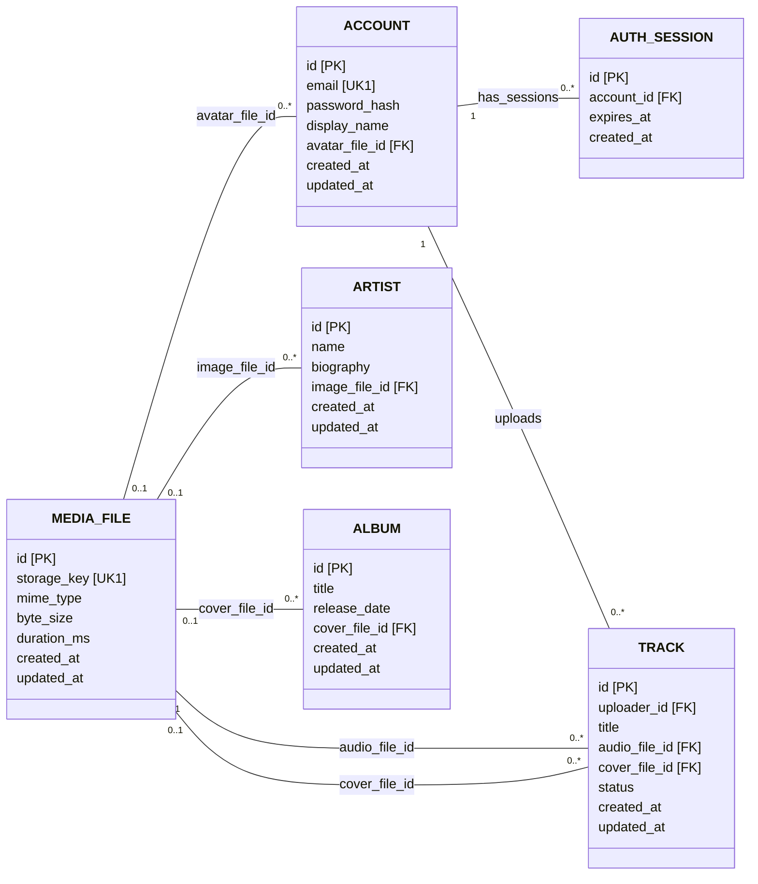
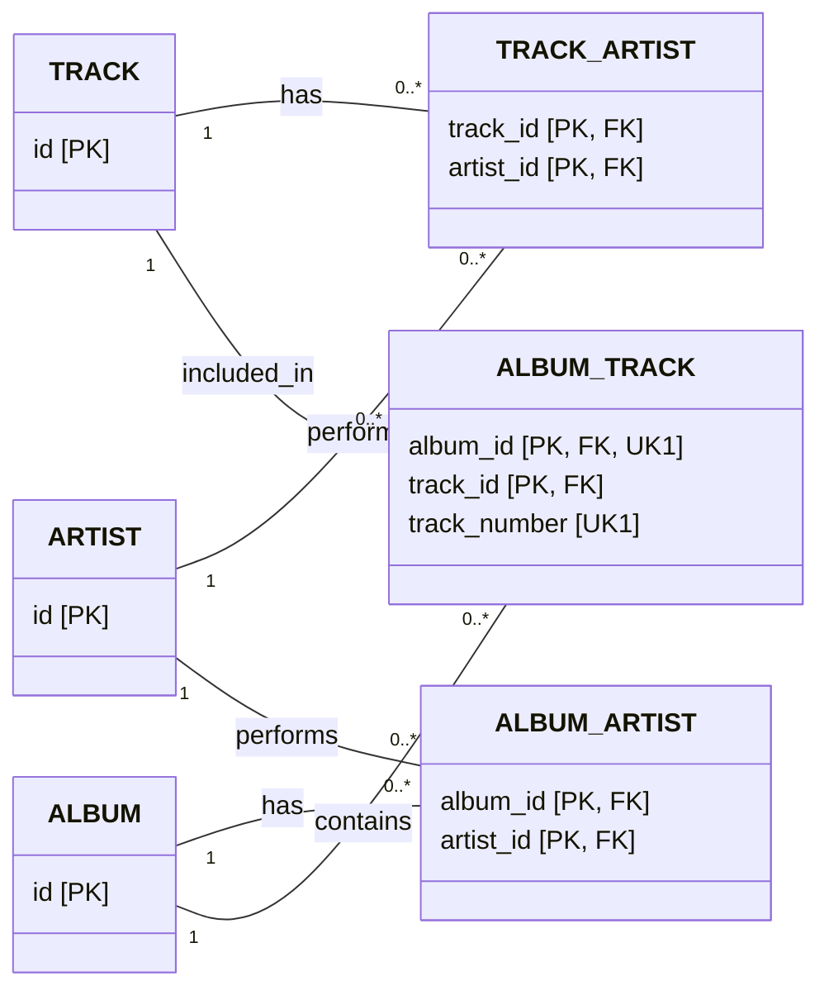
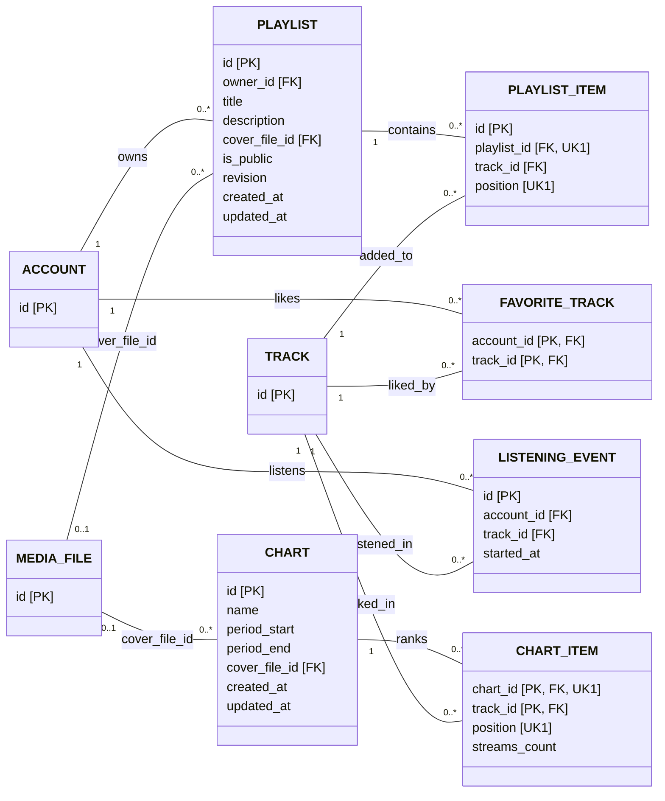
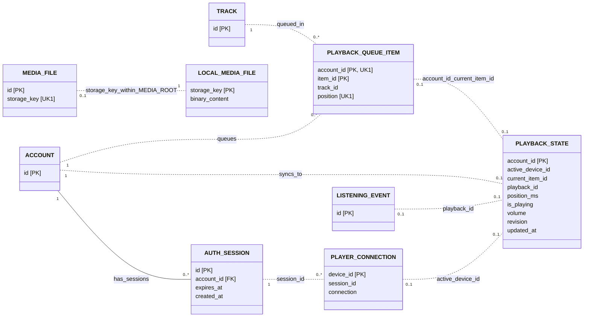

# ER Диаграммы модели данных

В PostgreSQL определены 15 прикладных таблиц, включая `auth_session` из миграции `000004_create_auth_session`.
Миграция `000005_media_local_storage` заменяет местоположение медиа на уникальный `storage_key` — относительный путь внутри каталога `MEDIA_ROOT` на диске сервера. Файлы этой миграцией не переносятся. Репозитории БД создают метаданные медиа и связывают аудиозапись с треком; файловый слой для байтов и HTTP-загрузка/скачивание пока не реализованы.

## 1. Основные сущности (PostgreSQL)

## 2. Исполнители и состав альбомов (PostgreSQL)

## 3. Плейлисты, чарты и история (PostgreSQL)

## 4. Диск сервера и проектируемые Redis и подключения плеера: логические связи с PostgreSQL

`AUTH_SESSION` уже хранится в PostgreSQL. Для файлов выбран диск сервера: `LOCAL_MEDIA_FILE.storage_key` соответствует пути внутри `MEDIA_ROOT`, а содержимое не входит в БД. Метаданные файлов создаются на уровне PostgreSQL-репозиториев; файловый слой, Redis для состояния плеера и очереди и WebSocket пока не реализованы. Диаграмма показывает связи модели этих подсистем. Перенос сессий в Redis не требуется.

